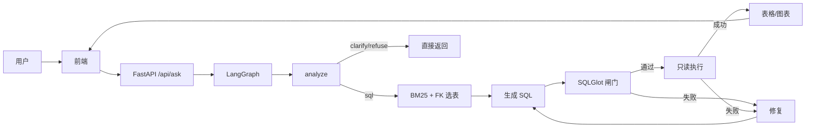

# AskData

[](https://github.com/AikingChoice/askdata-agent/actions/workflows/ci.yml)

一个面向电商分析场景的小型 Text-to-SQL Agent。

用户问“上月 GMV 是多少”“本月各品类销售额 top 3”，AskData 会先选表，再生成 SQL、做安全校验、在只读库上执行，最后返回表格或图表。缺少口径时先追问；敏感数据或写操作直接拒答。

> 当前是 demo：合成数据、单机 SQLite、无登录和限流，不是生产 BI 平台。

## 它解决什么问题

Text-to-SQL 的难点通常不是“写出 SQL 语法”，而是：

- 表多、列名含糊，模型选错表
- “销售额”这类口径没有定义，模型靠猜
- 生成的 SQL 越权、全表扫描、多语句执行
- SQL 报错后没有恢复，链路直接断
- 改了一版 prompt，不知道效果变好还是变坏

AskData 把这几件事拆成独立节点：语义路由、schema 检索、SQL 生成、SQL 闸门、只读执行、修复和评估。

## 功能

- 语义路由：`sql` / `clarify` / `refuse`
- Schema 检索：BM25 + 外键图
- SQL 生成：DeepSeek `deepseek-flash`，OpenAI 兼容
- SQL 安全：SQLGlot AST、单条 SELECT、表白名单、禁注释、强制 LIMIT
- 只读执行：SQLite `mode=ro` + `query_only` + 超时
- 修复循环：闸门或执行失败后回灌错误，最多 3 次
- 评估：40 条 golden，结果集对比
- 前端：聊天、表格、图表、SQL 展示
- 日志：JSONL trace，PII 拒答脱敏

## 工作流程

1. `analyze`：识别指标、时间、维度；缺信息就追问，遇到写操作/PII 就拒答
2. `retrieve`：BM25 召回相关表，再用外键图补 JOIN 表
3. `generate`：把 schema 和指标定义交给模型，生成 SQL
4. `guard`：SQLGlot 解析，只放行单条 SELECT，补 LIMIT
5. `execute`：在只读 SQLite 连接上执行，带超时和行数限制
6. `repair`：校验或执行失败时，把错误和上一版 SQL 回灌给模型重试

## 架构



## 快速开始

```bash
uv sync --extra dev
python scripts/load_db.py --fresh
uv run uvicorn app.main:app --reload --port 8000
```

打开 `http://127.0.0.1:8000`。如果 8000 被占用，换成 `--port 8012`。

配置模型：

```bash
cp .env.example .env
# LLM_MODE=deepseek
# DEEPSEEK_API_KEY=...
# DEEPSEEK_BASE_URL=https://api.deepseek.com
# DEEPSEEK_MODEL=deepseek-flash
```

没有 key 时会退回 Mock 模式，方便跑测试和看追问/拒答流程。

## API

```bash
curl -X POST http://127.0.0.1:8000/api/ask \
  -H "Content-Type: application/json" \
  -d '{"question":"上月 GMV 是多少？"}'
```

返回字段：

- `route`：`sql` / `clarify` / `refuse`
- `answer`：追问/拒答文本
- `sql`、`raw_sql`：执行 SQL 与模型原始 SQL
- `columns`、`rows`、`row_count`
- `analysis`：metric、time_range、dimensions、reason
- `attempts`、`trace`、`latency_ms`、`error`

其他接口：`GET /api/health`、`GET /api/schema`、`GET /docs`。

## 数据

`data/` 下是确定性合成数据：

- 日期维 730 天，12 个区域，5 个渠道，20 个商品，60 个客户，6 个活动，14 个销售
- 438 个订单，1,014 条明细，58 条退款
- 含区域别名、空渠道、空退款原因、部分退款、复购偏置等脏数据

数据字典见 [docs/data_dictionary.md](docs/data_dictionary.md)。

## 评估

```bash
python scripts/build_golden.py
python scripts/run_eval.py
```

40 条 golden，真实 DeepSeek：

| 指标 | 结果 |
|---|---:|
| 路由准确率 | 100.0% |
| Valid SQL Rate | 97.2% |
| Execution Accuracy | 91.7% |
| 追问/拒答正确率 | 100.0% |
| simple EX | 100.0% |
| moderate EX | 87.5% |
| challenging EX | 87.5% |

EX 使用结果集多重集比较，浮点保留 2 位；排名题只比较对象列，增长率题只比较增长列，额外证据列不惩罚。

完整报告见 [docs/eval_report.md](docs/eval_report.md)。目前还有 3 条失败：Q018 品类毛利率分摊、Q022 区域占比分组、Q036 连续 3 月毛利率下降时模型返回空 SQL。

## 开发

```bash
uv run pytest -q
python scripts/demo.py          # 真实 DeepSeek
python scripts/demo.py --mock   # 不调用外部模型
```

CI 会灌库、跑测试、校验 gold SQL、跑路由和检索评估。

## 部署

Docker：

```bash
docker compose up --build
```

镜像构建时会执行 `scripts/load_db.py --fresh` 生成演示库。`.env` 可选，不提供时走 Mock。

目前只跑了本地和 Docker，公网部署尚未执行。部署说明见 [docs/DEPLOY.md](docs/DEPLOY.md)。

## 目录

```text
app/
  main.py              FastAPI + 静态页面
  pipeline.py          LangGraph 状态图
  semantic.py          语义路由/追问/拒答
  schema_retrieval.py  BM25 + 外键图
  sql_guard.py         SQL 闸门
  executor.py          只读执行
  llm.py               DeepSeek / Mock
  static/index.html    前端
  observability.py     JSONL trace
data/
  schema.sql           10 表 DDL
  seed.sql             种子数据
  metrics.yml          指标/维度/歧义
  golden.jsonl         40 条评估集
docs/
  PLAN.md              方案
  data_dictionary.md   数据字典
  eval_report.md       评估报告
  DEPLOY.md            部署说明
scripts/
  load_db.py           灌库
  demo.py              5 问演示
  build_golden.py      构建/校验 gold SQL
  run_eval.py          真实评估
```

## 限制

- 合成数据，不代表真实业务分布；91.7% 是这 40 条用例上的结果，不是线上准确率。
- 只支持 SQLite demo；生产需要 Postgres、只读角色、RLS 和审计。
- 没有登录、权限和限流，当前是单用户 demo。
- 没有公网部署；没有外部 tracing 后端。
- 40 条评估集偏小，challenging 还有 3 条失败。
