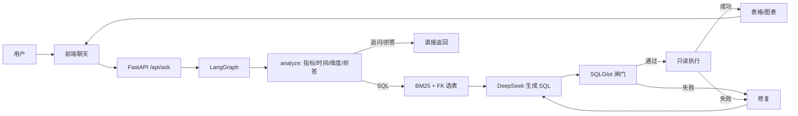

# AskData

[](https://github.com/AikingChoice/askdata-agent/actions/workflows/ci.yml)
[](https://render.com/deploy?repo=https://github.com/AikingChoice/askdata-agent)

可审计的 Text-to-SQL 数据问数 Agent：自然语言 → schema 检索 → SQL 生成 → 安全闸门 → 只读执行 → 表格/图表。

它不是“把建表语句塞给模型”的教程 Demo，而是一条带**追问、拒答、SQL 审计、修复循环和评估集**的完整链路。

## 当前状态

| 项 | 状态 |
|---|---|
| 数据 | SQLite 10 表 / 438 订单 / 1,014 明细 / 58 退款 |
| 模型 | DeepSeek `deepseek-flash`（OpenAI 兼容） |
| 编排 | LangGraph：分析 → 检索 → 生成 → 闸门 → 执行 → 修复 |
| 测试 | 34 passed |
| 评估 | 40 条 golden；路由 100%、Valid SQL 97.2%、EX 91.7%、拒答 100% |
| 前端 | 聊天 + 表格 + 图表 + SQL 审计 + 追问/拒答 |
| 工程 | 34 tests；GitHub Actions CI；JSONL trace |
| 部署 | Public GitHub repo + CI 绿；Render 一键部署入口已加，待登录/填 secret |

## 能力

- **SQL 路由**：问题可回答时生成并执行只读 SQL。
- **追问**：缺时间/维度/口径时先问，例如“最近销售怎么样”“上个月销售额是多少”。
- **拒答**：写操作、PII、数据源没有的主题直接拒绝，不生成 SQL。
- **Schema 检索**：BM25 + 外键图；10 表 demo 上 k=8 召回 100%。
- **SQL 安全**：SQLGlot AST、单条 SELECT、表白名单、禁注释、强制 LIMIT、只读连接、超时。
- **修复循环**：闸门/执行失败回灌错误，最多 3 次。
- **评估**：40 条 golden，执行结果集对比，不只比 SQL 字符串。
- **可观测**：每次响应返回 `attempts`、`trace`、`analysis`、延迟。

## 架构



## 快速开始

```bash
uv sync --extra dev
python scripts/load_db.py --fresh
uv run uvicorn app.main:app --reload --port 8000
# 打开 http://127.0.0.1:8000
```

如果 8000 被占用，换 `--port 8012`。

配置模型：

```bash
cp .env.example .env
# 编辑 .env：
# LLM_MODE=deepseek
# DEEPSEEK_API_KEY=...
# DEEPSEEK_BASE_URL=https://api.deepseek.com
# DEEPSEEK_MODEL=deepseek-flash
```

- 默认使用 DeepSeek `deepseek-flash`；`deepseek-chat` / `deepseek-reasoner` 已停用。
- Qwen `qwen-plus` 可作为意图/改写模型；`qwen-mt` 仅翻译，不用于 SQL 生成。
- 没有 key 时会退回 Mock 模式，适合跑测试与看追问/拒答流程。

## API

```bash
curl -X POST http://127.0.0.1:8000/api/ask \
  -H "Content-Type: application/json" \
  -d '{"question":"上月 GMV 是多少？"}'
```

响应字段：

- `route`：`sql` / `clarify` / `refuse`
- `answer`：追问/拒答文本
- `sql`、`raw_sql`：执行 SQL 与模型原始 SQL
- `columns`、`rows`、`row_count`
- `analysis`：metric、time_range、dimensions、reason
- `attempts`、`trace`、`latency_ms`、`error`

其他接口：

- `GET /api/health`
- `GET /api/schema`
- `GET /docs`

## 安全边界

1. 只允许单条 `SELECT` / `WITH...SELECT`。
2. 拒绝 DDL/DML、多语句、注释、限定表名、未知表。
3. 强制 `LIMIT 1000`；已有更小 LIMIT 保留。
4. SQLite `mode=ro` + `PRAGMA query_only=ON` + 进度看门狗超时。
5. 推理层先做语义路由：写操作/PII/无数据主题在生成 SQL 前拒答。
6. 高风险动作在生产版本应加人工审批（当前 demo 未做审批流）。

## 数据

`data/` 下是确定性合成数据：

- 日期维 730 天；12 区域；5 渠道；20 商品；60 客户；6 活动；14 销售。
- 438 订单、1,014 明细、58 退款。
- 含区域别名、状态枚举、空渠道、空退款原因、部分退款、复购偏置等脏数据。

数据字典见 [docs/data_dictionary.md](docs/data_dictionary.md)。

## 评估

```bash
python scripts/build_golden.py
python scripts/run_eval.py
```

最新结果（40 条，真实 DeepSeek）：

| 指标 | 结果 |
|---|---:|
| 路由准确率 | 100.0% |
| Valid SQL Rate | 97.2% |
| Execution Accuracy | 91.7% |
| 追问/拒答正确率 | 100.0% |
| simple EX | 100.0% |
| moderate EX | 87.5% |
| challenging EX | 87.5% |
| p95 延迟 | 8.9s |

EX 采用结果集多重集比较，浮点保留 2 位；排名题只比较对象列，增长率题只比较增长列，额外证据列不惩罚。

完整报告见 [docs/eval_report.md](docs/eval_report.md)。剩余失败：Q018 品类毛利率分摊、Q022 区域占比分组、Q036 连续 3 月毛利率下降的空 SQL。

## 演示

```bash
python scripts/demo.py          # 真实 DeepSeek
python scripts/demo.py --mock   # 不调用外部模型
```

演示覆盖：GMV、品类 Top 3、渠道退款率、追问、PII 拒答。

## Docker

```bash
docker compose up --build
```

镜像构建时会执行 `scripts/load_db.py --fresh` 生成演示库。`.env` 可选；不提供时走 Mock。

## 可观测

每次 `POST /api/ask` 会追加一条 JSONL trace 到 `data/traces.jsonl`（`TRACE_LOG_PATH` 可改）：

- `trace_id`、路由、analysis、选中表、SQL、attempts、trace、延迟、错误
- PII 拒答时问题会被写成 `[redacted]`
- 写文件失败不会影响请求
- 生产版本应接 Langfuse/OTel，并做日志脱敏与保留策略

## 部署

部署说明见 [docs/DEPLOY.md](docs/DEPLOY.md)，提供三种方式：

- Render：`render.yaml`，免费 Docker Web Service，推荐 demo 使用。
- Fly.io：`fly.toml`，需改 app 名称和 secret。
- VPS：Docker Compose + Nginx + HTTPS。

当前**没有已发布的公网 URL**：实际部署需要平台账号和 `DEEPSEEK_API_KEY` secret。CI 配置在 [.github/workflows/ci.yml](.github/workflows/ci.yml)。

Render 一键入口：<https://render.com/deploy?repo=https://github.com/AikingChoice/askdata-agent>。登录 Render → 选择 GitHub 仓库 → 填 `DEEPSEEK_API_KEY` → Deploy。

## 目录

```text
app/
  main.py              FastAPI + 静态页面
  pipeline.py          LangGraph 状态图
  semantic.py          语义路由/追问/拒答
  schema_retrieval.py  BM25 + 外键图
  sql_guard.py         SQL 闸门
  executor.py          只读执行
  llm.py               DeepSeek / Mock
  static/index.html    前端
  observability.py     JSONL trace
data/
  schema.sql           10 表 DDL
  seed.sql             种子数据
  metrics.yml          指标/维度/歧义
  golden.jsonl         40 条评估集
docs/
  PLAN.md              方案
  data_dictionary.md   数据字典
  eval_report.md       评估报告
  DEPLOY.md            部署说明
.github/workflows/ci.yml
scripts/
  load_db.py           灌库
  demo.py              5 问演示
  build_golden.py      构建/校验 gold SQL
  run_eval.py          真实评估
```

## 已知限制

- 合成数据，不代表真实业务分布；EX 是 demo 库上的结果，不是线上承诺。
- 只支持 SQLite demo；生产需要 Postgres + 只读角色 + RLS + 审计。
- 没有登录/权限/限流；当前是单用户 demo。
- 没有公网 URL、CI、tracing 后端；D10 继续补。
- 40 条评估集偏小，challenging 仍有 3 条失败。

## 面试讲法（30 秒）

“我做了一个可审计的数据问数 Agent：先做语义路由，缺口径先追问、敏感/写操作直接拒答；可回答时用 BM25+外键图选表，DeepSeek 生成 SQL，SQLGlot 闸门只放行单条 SELECT，再在只读连接上执行；失败会回灌修复最多 3 次；最后用 40 条 golden 测 execution accuracy，当前 91.7%。”

常见追问：

1. 为什么不是纯 Text-to-SQL？——先路由，避免该问不问、该拒不绝。
2. 为什么 BM25+外键图？——表少时 BM25 够用，外键图补 JOIN 表；大库再上向量+rerank。
3. 为什么 SQLGlot？——AST 级只读/白名单/LIMIT，不能靠正则。
4. 怎么防越权？——只读账号、白名单、RLS（生产）、超时、审计。
5. 怎么评估？——自建 golden + 结果集对比，不用榜单分数代替。
