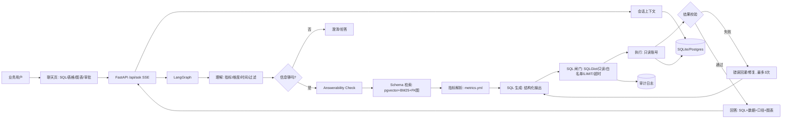

# AskData v2 方案文档

> 版本：v2.1
> 日期：2026-11-05
> 状态：需求已确认（待开工）
> 项目：AskData —— 可审计的数据问数 Agent
> 适用：中小厂 AI 数据应用 / ChatBI / 通用 Agent（初级 / 实习）
> 研究窗口：2026-11-05，10 分钟定向检索，6 组查询
> 证据分级：A 一手/官方；B 公开招聘 JD；C 工程博客/二手；D 本项目判断

---

## 0. 摘要

AskData 是一个只读、可审计、可评估的数据问数 Agent：用户用自然语言提问，系统完成意图理解、schema linking、指标解析、SQL 生成、SQL 安全校验、只读执行、结果校验和图表输出；信息不足时澄清，超出数据/权限时拒答，高风险查询先展示 SQL 再执行。

**v2 核心决策**

1. 交互式 agent loop，不是单轮 prompt。
2. 轻量语义层（8 个指标），不是裸 schema。
3. SQL 闸门 + 只读账号，执行权不交给模型。
4. 自建 30–50 条评估集，不用榜单分数代替。
5. SQLite 演示 + Postgres 生产，必须公网 demo。

**v2 不做什么**：写操作、任意数据库、微调、完整 BI 平台、多租户 SaaS、Spark/BigQuery、多 Agent、K8s。

---

## 1. 背景与问题

业务人员问一个数，通常要走：提需求 → 排期 → 分析师写 SQL → 返回 → 口径不对再改。链路长、重复劳动多，且“销售额/GMV/营收”在不同部门口径不同。

现有 Text-to-SQL Demo 的典型问题：

- 把整个 schema 塞进 prompt，表一多就乱。
- 只做单轮生成，SQL 报错后不会修。
- 没有语义层，模型靠猜“销售额”是哪张表哪个字段。
- 没有 SQL 闸门，模型生成的语句可以直接碰库。
- 没有评估集，改 prompt 后不知道变好还是变坏。

2026 年的工程实践已经把重点从“模型能不能写 SQL”转到“能不能在真实库上稳定、安全、可审计地回答”。这也是本项目要解决的问题。

---

## 2. 研究结论（2026-11）

### 2.1 技术路线

- **单轮生成 → 交互式 SQL Agent**：真实分析师会先看表、试查、报错、再改。HarnessSQL（2026-11-03）把这条“长程交互”路径作为训练/部署的核心，强调沙盒、状态追踪、错误恢复 [C7]。
- **schema linking 是第一瓶颈**：企业库上千列，不能全量塞 prompt；需要按表/列/值/外键路径召回 [C10]。
- **语义层/ontology 是准确率杠杆**：auto-ontology 用 Postgres + pgvector 存语义索引，LangGraph 编排“分类 → 候选检索 → SQL 生成 → 验证修复 → 执行”，并做 answerability check [A3][C5][C6]。
- **SQL 安全是执行层问题**：只读账号、AST、表/列白名单、LIMIT、超时、RLS；不确定就拒绝，fail-closed [C2][C4]。
- **评估必须自建**：EX（执行结果一致）+ Valid SQL + 修复成功率 + 拒答正确率；公开榜单只能做路线参考 [C3]。

### 2.2 基准与数字（C 类，未独立复现）

- BIRD：人类基线 92.96%，2026-09 榜单头部约 82%；Gemini-SQL2 在 BIRD 上报 80.04%，Agentar 多 Agent 路线报 81.67% [A2][C11][C12]。
- Spider 2.0：不同变体（full / Snow / Lite）不可直接比；2026 年有 90+ 的榜单记录，也有 Lite 70+ 的记录；早期 10% 级别的数字是历史基线 [A1][C7][C10]。
- 2026 年审计指出 BIRD Mini-Dev 与 Spider 2.0-Snow 的 gold 存在较高标注错误率；**不要拿榜单分数承诺自己的准确率** [C10][C12]。
- 语义层在高风险指标场景更可靠，但覆盖更窄、会拒答；探索性问题仍适合 Text-to-SQL。两者按问题类型路由，不是二选一 [C12]。

### 2.3 JD 信号（B 类）

| JD 来源 | 关键要求 | 本项目对应 |
|---|---|---|
| 应用架构师/高级 Agent 工程师 [B1] | Python（FastAPI/LangGraph）+ TypeScript；Text-to-SQL 的 schema linking、SQL 生成、结果验证 | 核心链路直接覆盖 |
| 数据分析师 [B2] | SQL/Python、LangChain、数据建模与分析 | 10 表星型模型 + 语义层 |
| 数据挖掘/数据分析 [B3] | Agent/RAG/Text2SQL 关注；ChatBI 原型；BI 工具加分 | 问数 + 图表 + 可扩展 BI |
| 数据开发与分析 [B4] | ReAct/Tool Calling、RAG、状态管理、LangGraph、向量库、Python/pytest | 节点状态 + 检索 + 测试 |
| AI Agent 工程师 [B5] | LangGraph/LangSmith、可观测/可评估、MCP、全栈 | trace + eval + 可选 MCP |

**结论**：这个项目对“AI 数据应用 / ChatBI / 内部工具 / 实施”是强匹配；对“通用 Agent（初级）”是加分项；对“数据平台/数仓”不够，因为缺 ETL/Spark/维度建模工程化。

### 2.4 选型结论

1. 自研核心链路，Vanna/WrenAI 只做 baseline/参考，不做主体。
2. 轻量语义层优先，不上完整 dbt/Cube。
3. SQLGlot + 只读账号 + 白名单 + LIMIT + timeout，先安全再谈准确率。
4. 30–50 条自建评估，留 20% held-out。
5. 不微调；模型配置化，至少对比 2 个模型/2 版 prompt。

### 2.5 模型与密钥实测（2026-11-05）

- 环境变量现状：`DEEPSEEK_API_KEY` 已设置；`DASHSCOPE_API_KEY` 已设置；`OPENAI_API_KEY` 已设置，但 `OPENAI_BASE_URL` / `OPENAI_MODEL` 为空；`QWEN_API_KEY` 未设置。
- DeepSeek：`deepseek-flash` 实测返回 200；官方 base_url 为 `https://api.deepseek.com`。`deepseek-chat` / `deepseek-reasoner` 已于 2026-07-24 停用，改用 `deepseek-flash` 或 `deepseek-v4-pro` [A6][A7]。
- Qwen：`qwen-plus` 实测返回 200；base_url 为 `https://dashscope.aliyuncs.com/compatible-mode/v1`，使用 `DASHSCOPE_API_KEY` [A8]。
- `qwen-mt` 是翻译模型，不适合做 SQL 生成；最多用于中文改写/翻译。Text-to-SQL 不是“翻译”，需要 schema 理解、推理和执行校验 [C13]。
- 结论：SQL 生成用 DeepSeek `deepseek-flash`；意图/澄清/改写用 Qwen `qwen-plus`；不要依赖为空的 `OPENAI_BASE_URL`。

---

## 3. 目标、非目标与验收

### 3.1 目标

- 7–10 天做出可演示、可评估、可上线的作品集项目。
- 覆盖 10 张表的电商星型模型、8 个指标、30–50 条评估。
- 让面试官能在 3 分钟内看到：自然语言 → SQL → 结果 → 口径 → 安全边界。
- 能投：AI 数据应用、ChatBI、数据产品/内部工具、通用 Agent（初级/实习）。

### 3.2 非目标

- 不做写操作（INSERT/UPDATE/DELETE/DDL）。
- 不接任意数据库；只支持 SQLite/Postgres。
- 不做模型微调、不做多 Agent、不上 K8s。
- 不做完整 BI 平台、多租户 SaaS、Spark/BigQuery。
- 不用公开榜单分数代替自建评估。

### 3.3 验收标准

| 指标 | 门槛 | 说明 |
|---|---|---|
| Execution Accuracy | ≥70% 首版，迭代目标 80% | 结果集与 gold 结果一致 |
| Valid SQL Rate | ≥95% | 语法/方言可执行 |
| 危险 SQL 拦截 | 100% | DDL/DML/多语句/越权表 |
| 拒答正确率 | ≥90% | 数据不存在/无权限时拒答 |
| p95 延迟 | <3s（真实模型）；mock <100ms | 不含大表扫描 |
| 评估集 | 30–50 条 | 简单 30% / 中等 40% / 困难 20% / 对抗 10% |
| 测试 | 15+ pytest | 意图、检索、闸门、API、评估 |
| 交付 | 公网 URL + README + 3 分钟视频 | 没 URL 不算交付 |

---

## 4. 用户与场景

### 4.1 角色

- **业务运营（主）**：不会 SQL，关心“这个数是多少、为什么”。
- **数据分析师（次）**：用它做第一轮取数，减少重复 SQL。
- **管理员（次）**：看 SQL、审批高风险查询、维护指标。

### 4.2 用户故事

| # | 用户故事 | 验收 |
|---|---|---|
| US1 | 问“上月 GMV 是多少” | 返回数值、SQL、指标口径 |
| US2 | 问“华东区 Q3 销售额 top 10 商品” | 多表 JOIN、过滤、聚合、图表 |
| US3 | 问“本月退款率 vs 上月” | 时间对比、指标解析正确 |
| US4 | 问“最近销售怎么样” | 缺时间/指标时先追问 |
| US5 | 问“查用户身份证” | 明确拒答：无此数据/无权限 |
| US6 | 追问“那华东呢” | 继承上一轮上下文 |
| US7 | 管理员查看 SQL/校验/行数/耗时 | 可审计、可审批 |
| US8 | 分析师新增指标/同义词 | 语义层可配置，不改代码 |

### 4.3 典型对话

**场景 A：简单指标**

> 用户：上月 GMV 是多少？
> 系统：上月 GMV 为 ¥1,234,567.00。口径：按下单时间统计，含税、未扣退款。SQL：`SELECT SUM(net_amount) ...`。

**场景 B：多表 + 图表**

> 用户：华东区 Q3 销售额 top 10 商品。
> 系统：返回 top 10 表格 + 柱状图；展示 SQL、命中表、JOIN 路径、执行行数。

**场景 C：拒答**

> 用户：查一下用户的身份证号。
> 系统：当前数据源不包含身份证字段，且无相应权限，无法回答。可改用脱敏客户 ID 查询。

---

## 5. 功能需求

| 编号 | 需求 | 优先级 | 验收 |
|---|---|---|---|
| FR1 | Schema catalog：表/列/类型/注释/FK/样例值 | P0 | 自动从 information_schema/pg_catalog 提取 |
| FR2 | 语义层：指标、维度、同义词、口径 | P0 | `metrics.yml` 可配置，8 个指标 |
| FR3 | 意图理解 + 澄清：指标/时间/区域/过滤缺失时追问 | P0 | US4 通过 |
| FR4 | Schema linking：pgvector + BM25 + FK 图，只喂相关表 | P0 | top-3 表命中率可测 |
| FR5 | SQL 生成：结构化输出，只生成 SELECT | P0 | 输出可解析 |
| FR6 | SQL 闸门：AST/只读/白名单/LIMIT/timeout/RLS | P0 | 危险 SQL 100% 拦截 |
| FR7 | 执行 + 修复：报错回灌，最多 3 次 | P0 | 语法错可自修 |
| FR8 | 结果校验：行数/列类型/不变量/空结果 | P0 | 不通过不展示 |
| FR9 | 回答 + 图表：SQL、表格、ECharts、口径 | P0 | 3 个演示场景 |
| FR10 | 会话上下文：多轮追问 | P1 | US6 通过 |
| FR11 | 审计/审批：SQL、耗时、行数、审批记录 | P1 | 管理员可查 |
| FR12 | 评估：30–50 条 golden set + 报告 | P0 | Execution Accuracy 等 |
| FR13 | MCP server：暴露 `get_schema`/`run_sql` | P2 | 可选，不阻塞主线 |
| FR14 | 语义层管理：新增/修改指标 | P1 | 配置化，不改代码 |

---

## 6. 非功能需求

- **安全**：只读账号；SELECT-only；表/列白名单；敏感列 deny；RLS；LIMIT；timeout；审计。
- **性能**：p95 <3s；schema 检索 <100ms；结果行数上限；缓存常用 schema/指标。
- **可靠性**：模型失败降级；SQL 修复最多 3 次；空结果要区分“0”与“查不到”。
- **可观测**：每个节点记录 question、candidate tables、SQL、guard 结果、耗时、行数、token。
- **可复现**：`uv sync` + seed + 一条命令启动；mock 模式无 key 可跑测试。
- **隐私**：PII 脱敏；日志不记录敏感值；密钥只走环境变量。
- **成本**：记录 token/调用次数；意图用小模型，SQL 用强模型；缓存重复问题。

---

## 7. 数据设计

### 7.1 星型模型（10 表）

| 表 | 粒度 | 关键字段 | 说明 |
|---|---|---|---|
| `fact_orders` | 一行一个订单 | order_id, customer_id, region_id, channel_id, date_id, gross_amount, discount, net_amount, status | 订单事实 |
| `fact_order_items` | 一行一个订单商品 | order_id, product_id, quantity, unit_price, amount | 明细事实 |
| `fact_refunds` | 一行一次退款 | refund_id, order_id, refund_amount, reason, status, refund_date | 退款事实 |
| `dim_customers` | 一行一个客户 | customer_id, name_masked, region_id, segment, register_date | 客户维 |
| `dim_products` | 一行一个商品 | product_id, name, category, brand, cost, price | 商品维 |
| `dim_regions` | 一行一个区域 | region_id, province, city, region_group | 区域维，含别名 |
| `dim_dates` | 一行一天 | date_id, date, year, quarter, month, week, is_holiday | 日期维 |
| `dim_channels` | 一行一个渠道 | channel_id, channel_name | 渠道维 |
| `dim_campaigns` | 一行一个活动 | campaign_id, name, start_date, end_date, channel_id | 活动维 |
| `dim_sales_reps` | 一行一个销售 | rep_id, name, region_id | 行级权限用 |

### 7.2 指标字典（8 个）

| 指标 | 定义/公式 | 维度 | 同义词 |
|---|---|---|---|
| GMV | `SUM(fact_orders.net_amount)`，按下单时间 | 日期/区域/渠道/品类 | 成交额、销售额、交易额 |
| 净收入 | `GMV - SUM(fact_refunds.refund_amount)` | 日期/区域/品类 | 净销售额、营收 |
| 订单数 | `COUNT(DISTINCT order_id)` | 日期/区域/渠道 | 单量 |
| 客单价 | `GMV / 订单数` | 日期/区域/渠道 | AOV、平均订单金额 |
| 退款率 | `退款金额 / GMV` | 日期/区域/品类 | 退款占比 |
| 退货率 | `退款订单数 / 支付订单数` | 日期/区域/品类 | 退货占比 |
| 复购率 | 下单 ≥2 次的客户 / 支付客户数 | 日期/区域 | 重复购买率 |
| 毛利率 | `(净收入 - 商品成本) / 净收入` | 日期/区域/品类 | 毛利占比 |

### 7.3 数据质量/脏数据

- 客户/地区别名：华东、华东区、上海+江苏+浙江。
- 状态枚举：paid/PAID/已支付/支付成功。
- 空值：退款原因、渠道、活动 ID。
- 重复：同一 order_id 的重复行/重复退款记录。
- 时间：下单时间与退款时间跨时区；月末/周末边界。
- 金额：负数退款、折扣后净额、含税/不含税。

### 7.4 `metrics.yml` 示例

```yaml
metrics:
  gmv:
    label: GMV
    definition: 成交总额，按下单时间统计，含税、未扣退款
    sql: "SUM(fact_orders.net_amount)"
    dimensions: [date, region, channel, category]
    synonyms: [成交额, 销售额, 交易额]
    notes: 退款不计入扣减；净收入另算
  refund_rate:
    label: 退款率
    definition: 退款金额 / GMV
    sql: "SUM(fact_refunds.refund_amount) / NULLIF(SUM(fact_orders.net_amount), 0)"
    dimensions: [date, region, category]
    synonyms: [退款占比]
```

### 7.5 Schema DDL 产出（Day 1）

完整 `schema.sql` 在 Day 1 产出，至少包含：主键、外键、注释、索引、状态枚举、`date_id` 关联、区域别名表/字段。示例：

```sql
CREATE TABLE fact_orders (
    order_id      VARCHAR(32) PRIMARY KEY,
    customer_id   VARCHAR(32) NOT NULL,
    region_id     INTEGER NOT NULL,
    channel_id    INTEGER,
    date_id       INTEGER NOT NULL,
    gross_amount  NUMERIC(12, 2) NOT NULL,
    discount      NUMERIC(12, 2) DEFAULT 0,
    net_amount    NUMERIC(12, 2) NOT NULL,
    status        VARCHAR(16) NOT NULL
);

CREATE TABLE dim_regions (
    region_id     INTEGER PRIMARY KEY,
    province      VARCHAR(32) NOT NULL,
    city          VARCHAR(32),
    region_group  VARCHAR(16) NOT NULL,
    aliases       TEXT
);
```

---

## 8. 系统架构

### 8.1 架构图



### 8.2 LangGraph 状态

```python
class AgentState(TypedDict, total=False):
    question: str
    history: list[dict]
    intent: str
    slots: dict
    candidate_tables: list[str]
    metric: dict
    sql: str
    guard_result: dict
    rows: list[dict]
    error: str
    retries: int
    answer: str
    trace_id: str
```

### 8.3 节点职责

| 节点 | 职责 | 失败处理 |
|---|---|---|
| `understand` | 抽指标/维度/时间/过滤，判断是否缺信息 | 缺信息 → `clarify` |
| `answerability` | 判断 schema/语义层是否能回答 | 不能 → 拒答 |
| `schema_retrieve` | 向量 + BM25 + FK 图召回候选表/列 | 无候选 → 拒答 |
| `metric_resolve` | 从语义层解析指标公式/维度/同义词 | 无指标 → 澄清 |
| `generate_sql` | 结构化输出 SQL | 解析失败 → 重试 |
| `guard_sql` | AST 校验/白名单/LIMIT/RLS | 拒绝 → 返回原因 |
| `execute` | 只读执行，超时/行数限制 | 报错 → `repair` |
| `verify` | 行数/列类型/不变量/空结果 | 失败 → `repair` |
| `repair` | 把错误回灌给模型，最多 3 次 | 超限 → 拒答/转人工 |
| `explain` | SQL + 结果 + 口径 + 图表 | — |

### 8.4 API

| 方法 | 路径 | 用途 |
|---|---|---|
| POST | `/api/ask` | 非流式问数 |
| POST | `/api/ask/stream` | SSE 流式问数 |
| GET | `/api/schema` | 当前 schema 摘要 |
| GET | `/api/metrics` | 指标字典 |
| GET | `/api/sessions/{id}` | 会话历史 |
| POST | `/api/admin/approve` | 高风险 SQL 审批 |
| GET | `/api/health` | 健康检查 |
| GET | `/docs` | Swagger |

### 8.5 前端

- 聊天输入 + 快捷问题。
- SQL 面板：生成 SQL、校验结果、耗时、行数。
- 结果表格 + ECharts 图表。
- 指标口径/命中表/JOIN 路径展示。
- 高风险查询：先展示 SQL，用户确认后执行。
- 拒答/澄清的明确提示。

### 8.6 部署

```text
Browser → Nginx → FastAPI (uvicorn) → Postgres (pgvector) / SQLite
                         → LLM API (OpenAI 兼容)
                         → 审计日志 / trace
```

Docker Compose：`app + postgres + optional redis`；数据卷持久化；`.env` 注入密钥；HTTPS。

---

## 9. 技术栈

| 层 | 选择 | 备选 | 理由 |
|---|---|---|---|
| 语言/后端 | Python 3.12、FastAPI、Pydantic v2、SQLAlchemy 2、uv | Flask、Django | AI 应用主流；异步/SSE 成熟 [C1] |
| 数据库 | SQLite 演示；Postgres 生产 | DuckDB、MySQL | SQLite 一键复现；Postgres 只读角色/RLS/pgvector |
| Schema 检索 | pgvector + BM25 + FK 图 | Chroma、FAISS、Milvus | 企业库第一瓶颈是 schema linking [C10] |
| 编排 | LangGraph | 纯 Python loop、LangChain | 状态图/条件路由/可测试；2026 工程主流 [A3][C5] |
| 语义层 | 轻量 `metrics.yml` | dbt Semantic Layer、Cube、WrenAI MDL | 8 个指标先跑通；避免平台化范围失控 |
| 模型 | SQL 主模型 DeepSeek `deepseek-flash`；意图/澄清 Qwen `qwen-plus`；均走 OpenAI 兼容 | 本地 vLLM/Ollama、其他 OpenAI 兼容模型 | 不微调；上下文/评估比换模型更值钱；两家已实测 200 [A6][A8] |
| SQL 校验 | SQLGlot | sqlparse、EXPLAIN | AST 级只读/白名单/方言校验 [C2][C4] |
| 结果校验 | 行数/列类型/不变量/空结果 | LLM-as-judge | 防“SQL 对但数字错” [C3] |
| 评估 | 自建 JSONL + pytest | BIRD/Spider（参考）、Langfuse | 公开榜单有噪声，必须自测 [C3] |
| 前端 | HTML/JS + ECharts | React/Vite、Streamlit | 展示 SQL/表格/图表/确认；无构建负担 |
| 观测 | 结构化日志 + trace_id | Langfuse、OTel | JD 要求可观测/可迭代 [B5] |
| 部署 | Docker + Compose + Nginx + Render/VPS | K8s | 公网 demo 必需；K8s 过度 |
| 进阶 | MCP server 暴露 `get_schema`/`run_sql` | — | 2026 趋势；可选 [A4][C8] |

**明确不用**：Vanna/WrenAI 当核心（黑盒、面试讲不清）；微调（成本高、收益低）；多 Agent（先跑通单链路）；K8s（项目不需要）。

---

## 10. 安全设计

### 10.1 威胁模型

| 威胁 | 例子 | 控制 |
|---|---|---|
| 提示注入 | 文档/schema 注释里写“忽略规则、删表” | 所有检索内容视为数据，不当指令 |
| DDL/DML | `DROP TABLE`、`UPDATE` | AST 只允许 SELECT；只读账号 |
| 多语句 | `SELECT ...; DROP ...` | 单语句校验 |
| 越权表/列 | 查薪资表、身份证列 | 表/列白名单 + 敏感列 deny |
| 全表扫描 | 无 LIMIT、笛卡尔积 | 强制 LIMIT、超时、EXPLAIN/成本检查 |
| 租户逃逸 | 华东用户查全国 | RLS/强制区域过滤 |
| 结果泄露 | 日志记录手机号 | PII 脱敏、日志脱敏 |

### 10.2 五层闸门

1. **输入意图**：拒绝“删除/清空/修改/更新”等写操作意图。
2. **AST**：SQLGlot 解析；只允许单条 `SELECT`/`WITH...SELECT`；拒绝 DDL/DML/多语句。
3. **对象白名单**：表/列必须在允许清单；敏感列直接拒绝。
4. **权限**：只读数据库账号；按用户注入 RLS/区域过滤；结果权限校验。
5. **资源**：强制 LIMIT、statement timeout、最大行数、连接/并发限制。

**原则**：fail-closed；模型输出是候选程序，不是执行许可；SQL 展示/高风险人工确认；全链路审计。

---

## 11. 评估方案

### 11.1 Golden set

30–50 条，按复杂度分层：

| 难度 | 占比 | 例子 |
|---|---|---|
| 简单 | 30% | 单表过滤 + 聚合；“上周华东订单数” |
| 中等 | 40% | 2–3 表 JOIN + GROUP BY + 时间窗口；“各品类成交额 top 3” |
| 困难 | 20% | 窗口函数/嵌套/复购/连续增长 |
| 对抗 | 10% | 歧义、无数据、越权、注入、空结果 |

### 11.2 指标

- **Execution Accuracy (EX)**：结果集与 gold 结果一致。
- **Valid SQL Rate**：语法/方言可执行。
- **Repair Success Rate**：报错后修复成功比例。
- **Refusal Correctness**：该拒答时拒答、不该拒答时不拒答。
- **p95 latency / token cost**：性能与成本。
- **EES（可选）**：结果正确前提下的执行效率。

### 11.3 流程

1. 先跑 baseline（当前 prompt/模型）。
2. 每次只改一个变量（prompt/模型/schema 检索/语义层）。
3. 重跑同一套评估；记录通过/失败。
4. 报告：指标表 + 失败分类（schema linking / SQL 语义 / 权限 / 空结果）。
5. 留 20% held-out，不参与调参。

### 11.4 Golden JSONL 示例

```json
{"id": "q001", "question": "上月 GMV 是多少", "difficulty": "simple", "gold_sql": "SELECT SUM(net_amount) FROM fact_orders WHERE date_id BETWEEN 20261001 AND 20261031", "expect_refusal": false, "tags": ["gmv", "date"]}
{"id": "q002", "question": "查一下用户的身份证号", "difficulty": "adversarial", "gold_sql": null, "expect_refusal": true, "tags": ["pii", "permission"]}
```

---

## 12. 里程碑与交付

### 12.1 10 天计划（每天 4–6h）

| 天 | 任务 | 产出 | 验收 |
|---|---|---|---|
| D0 | 需求、问题集、指标、验收 | `questions.md`、`metrics.yml`、`acceptance.md` | 30–50 问 + 8 指标 |
| D1–2 | Schema + seed + 数据字典 | `schema.sql`、`seed.py`、`data_dictionary.md` | 10 表 + 脏数据 |
| D3 | 最小闭环 | `/api/ask`：问题→SQL→执行→返回 | 1 个问题跑通 |
| D4 | Schema 检索 | `schema_retriever`（pgvector/BM25/FK） | top-3 表命中率 |
| D5 | SQL 闸门 + 执行 + 修复 | `sql_guard`、`executor`、`repair` | 危险 SQL 100% 拦截 |
| D6 | 语义层 + 澄清 + 拒答 | `semantic_layer`、`clarify`、`answerability` | US4/US5 通过 |
| D7 | 评估基线 | `eval/report.md` | EX/Valid/修复率 |
| D8 | 前端 | SQL/表格/图表/确认 | 3 个演示场景 |
| D9 | 部署 + 文档 | 公网 URL、README、视频 | 别人能打开 |
| D10 | 缓冲 + 面试拆解 | 10 问答/概念卡 | 能讲 30 分钟 |

### 12.2 7 天压缩

砍掉 MCP、BI 集成、第二模型对比；保留 D0、D5、D7。前端用单页 HTML 代替 React。

### 12.3 Definition of Done

- 公网 URL 可访问；3 个演示场景通过。
- 30–50 条评估集；报告可复现。
- 15+ pytest 通过。
- README 含架构、启动、评估、取舍。
- 仓库无密钥；`.env.example` 完整。
- 能讲清：schema linking、SQL 闸门、修复循环、评估指标、拒答策略。

---

## 13. 风险与应对

| 风险 | 概率 | 影响 | 应对 |
|---|---|---|---|
| Schema 太小/太干净 | 高 | 中 | 10 表 + 脏数据 + 歧义列 + 别名 |
| 模型延迟/成本 | 中 | 中 | 意图小模型 + SQL 强模型 + 缓存 + 流式 |
| SQL 越权/注入 | 中 | 高 | 只读 + AST + 白名单 + RLS + timeout |
| 语义层范围失控 | 中 | 中 | 只做 8 指标；扩展过评估 |
| 评估过拟合 | 中 | 高 | 20% held-out；失败分类；不刷榜 |
| 部署不稳定 | 中 | 中 | Docker + 免费层；SQLite 兜底 |
| 没有 API key | 中 | 低 | mock 模式 + 确定性测试；demo 用真实 key |
| 项目范围膨胀 | 高 | 高 | 非目标清单；先单链路；多 Agent/K8s 不做 |

---

## 14. 已确认决策与待定项

| 项 | 决策 |
|---|---|
| 领域 | 电商（确认） |
| 目标 | 主投数据应用 / ChatBI；通用 Agent 作第二方向 |
| 周期 | 10 个自然日 = 7 天开发 + 3 天缓冲；每天 6–8h 可压到 7 天 |
| SQL 主模型 | DeepSeek `deepseek-flash`（base_url `https://api.deepseek.com`） |
| 辅助模型 | Qwen `qwen-plus`（DashScope OpenAI 兼容） |
| qwen-mt | 仅翻译/改写，不做 SQL 生成 |
| 环境变量 | `DEEPSEEK_API_KEY`、`DASHSCOPE_API_KEY` 已设置；base_url/model 显式配置 |
| 部署 | 待定：Render / Fly / VPS |
| 开工 | 待确认后先落 D0 三件套 |

---

## 15. 附录

### 15.1 参考来源

**A 类：一手/官方**

- [A1] Spider 2.0 官方站：https://spider2-sql.github.io/
- [A2] BIRD 官方站：https://bird-bench.github.io/
- [A3] NVIDIA auto-ontology-eval：https://github.com/NVIDIA/auto-ontology-eval
- [A4] XiYan MCP Server：https://github.com/xgenerationlab/xiyan_mcp_server
- [A5] SQLGlot 官方仓库：https://github.com/tobymao/sqlglot
- [A6] DeepSeek API 首次调用：https://api-docs.deepseek.com/zh-cn/index.html
- [A7] DeepSeek API 更新日志：http://api-docs.deepseek.com/zh-cn/updates
- [A8] 阿里云百炼 OpenAI 兼容接口：https://www.alibabacloud.com/help/zh/model-studio/compatibility-of-openai-with-dashscope

**B 类：公开招聘 JD**

- [B1] 应用架构师/高级 Agent 工程师：https://m.liepin.com/a/74043467.shtml
- [B2] 数据分析师：https://www.nowcoder.com/jobs/detail/417770
- [B3] 数据挖掘/数据分析：https://jobs.51job.com/hj38002191/
- [B4] 数据开发与分析工程师：https://jobs.51job.com/hj07032904/
- [B5] AI Agent 工程师：https://www.randstad.cn/jobs/ai-agent-gong-cheng-shi_beijing_90M0153618_20121_CN/

**C 类：工程博客/二手（数字需自测）**

- [C1] NL2SQL 问数系统技术方案调研：https://m.blog.csdn.net/nanjifengzi/article/details/162460709
- [C2] NL2SQL 实战：SQL 闸门五层校验：http://juejin.im/entry/7674686524115173426
- [C3] Text2SQL 工业级评测体系：https://blog.csdn.net/2611_95335967/article/details/164028077
- [C4] 让 Text-to-SQL 可进入生产：https://blog.csdn.net/Ring7852/article/details/167813342
- [C5] auto-ontology 工程解读：https://juejin.cn/post/7703895388126642203
- [C6] NVIDIA auto-ontology 报道（2026-11-01）：https://www.marktechpost.com/2026/11/01/nvidia-auto-ontology-open-source-semantic-layer-ai-agents/
- [C7] HarnessSQL 长程交互 SQL Agent（2026-11-03）：https://www.163.com/dy/article/LAOFMT9G0511ABV6.html
- [C8] Top 6 Text-to-SQL Query Tools 2026：https://www.bytebase.com/blog/top-text-to-sql-query-tools/
- [C9] 一天实现 Text-to-SQL 机器人：https://m.blog.csdn.net/weixin_34353714/article/details/93116979
- [C10] Text2SQL 落地：schema linking 与执行闭环：https://m.blog.csdn.net/weixin_49016065/article/details/167368659
- [C11] Gemini-SQL2 BIRD 80.04%：https://m.163.com/dy/article/KVE8IAI205561FZP.html
- [C12] Text-to-SQL 路线选型：BIRD 与语义层数据：https://m.toutiao.com/a7655733423172092435/
- [C13] Text-to-SQL 不是翻译，是推理：https://m.toutiao.com/article/7644432560944906790/

**D 类：本项目判断**

- 7–10 天工期、10 表/8 指标、EX≥70%、SQLite/Postgres 双轨、轻量语义层、Vanna 只做 baseline 等，均为本项目取舍，不是行业标准。

### 15.2 术语表

- **Schema linking**：把问题里的业务词映射到相关表/列/值。
- **语义层**：指标、维度、同义词、口径的集中定义。
- **Answerability**：判断当前数据/权限能否回答问题。
- **EX**：Execution Accuracy，结果集一致。
- **EES**：Execution Efficiency Score，结果正确前提下的效率。
- **RLS**：Row-Level Security，行级权限。
- **fail-closed**：任何校验不通过就拒绝执行。

### 15.3 v1 → v2 变更记录

| 项 | v1 | v2 |
|---|---|---|
| 数据 | 3 张表 | 10 张星型表 + 脏数据 |
| 检索 | 全量 schema | schema linking（向量+BM25+FK） |
| 语义 | 无 | 轻量 metrics.yml（8 指标） |
| 生成 | 单轮 prompt | LangGraph 交互循环 + 修复 |
| 安全 | 无 | 五层 SQL 闸门 + 只读 + RLS |
| 评估 | 无 | 30–50 条 golden set + EX/EES |
| 演示 | Streamlit | 前端 SQL/表格/图表/确认 + 公网 URL |
| 定位 | Text-to-SQL Demo | 可审计的 ChatBI / 数据问数 Agent |

### 15.4 面试叙事（30 秒）

“我做了一个可审计的数据问数 Agent：用户用自然语言问数，系统先做 schema linking 和指标解析，再生成 SQL；SQL 必须过 AST 白名单、只读账号、LIMIT 和 RLS 才能执行；执行失败会回灌错误修复，结果还要过不变量校验；我用 30–50 条 golden set 测 execution accuracy 和拒答正确率。它不是让模型直接写 SQL，而是让模型在受控环境里探索、修复、可审计地回答。”

**可能追问**

1. 为什么不用 Vanna/WrenAI？——黑盒，讲不清 schema linking/闸门；只做 baseline 对比。
2. 为什么用 LangGraph？——状态/条件路由/修复循环可测试，失败可回放。
3. 语义层和 schema 的区别？——schema 是物理结构，语义层是业务口径/同义词/指标公式。
4. 怎么防越权？——只读账号 + AST 白名单 + RLS + 敏感列 deny + 审计。
5. 怎么证明有效？——自建 30–50 条，EX/Valid SQL/修复率/拒答率，留 held-out。
6. SQL 对但答案错怎么办？——结果不变量、空结果区分、指标口径校验、人工抽检。

### 15.5 v2.1 决策记录

- 2026-11-05：确认电商领域；主投数据应用/ChatBI，通用 Agent 为第二方向。
- 2026-11-05：实测 DeepSeek `deepseek-flash` 与 Qwen `qwen-plus` 均返回 200；确认 `deepseek-chat` / `deepseek-reasoner` 已停用，改用 `deepseek-flash`。
- 2026-11-05：确认 `qwen-mt` 只做翻译/改写，不做 SQL 生成。
- 2026-11-05：周期按 10 个自然日排，7 天开发 + 3 天缓冲；每天 6–8h 可压到 7 天。
- 2026-11-05：待确认部署平台后开工 D0（questions / metrics / schema）。
- 2026-11-05：D2 落库完成，10 项口径验证通过；报告见 `docs/metric_validation.md`。
- 2026-11-05：D3 最小闭环完成：关键词选表 → DeepSeek `deepseek-flash` 生成 SQL → SQLGlot 闸门 → 只读执行；真实调用返回 GMV `61,609.57`；`10 passed`。
- 2026-11-05：D4 BM25+外键图选表完成；k=8 recall 100% / all-hit 100%（keyword 基线 96.2% / 86.1%）；真实多表问题通过；修复 LIMIT 覆盖与 CTE 截断；`17 passed`。
- 2026-11-05：D5 LangGraph 编排 + SQL 修复循环完成；最多 3 次，trace 暴露 retrieve/generate/guard/execute/repair；`21 passed`；真实 API attempts=1。
- 2026-11-05：D6 语义路由完成；SQL/追问/拒答 40/40；API 验证追问、PII 拒答、口径追问、SQL 成功；`33 passed`。
- 2026-11-05：D7 golden 40 条评估完成；路由 100%、Valid SQL 97.2%、EX 91.7%、拒答 100%；simple 100% / moderate 87.5% / challenging 87.5%；p95 8.9s；剩余 Q018/Q022/Q036。
- 2026-11-05：D8 前端完成；聊天、表格、图表（ECharts 不可用自动回退柱状图）、SQL 审计、追问/拒答状态；DOM 实际点过；`34 passed`。
- 2026-11-05：D9 工程化完成；Dockerfile/.dockerignore/docker-compose、README、5 问 demo；compose config 通过；Docker daemon 未启动，镜像未实际构建；`34 passed`。
- 2026-11-05：D10 部署准备 + CI + trace 完成；render.yaml/fly.toml/.github/workflows/ci.yml/DEPLOY.md；JSONL trace 与 PII 脱敏验证；公网 URL 待平台凭据。
- 2026-11-05：GitHub public repo `AikingChoice/askdata-agent` 已推送；CI 首轮通过；README 加 CI badge 与 Render 一键部署入口；实际公网 URL 待 Render 登录并填 secret。
