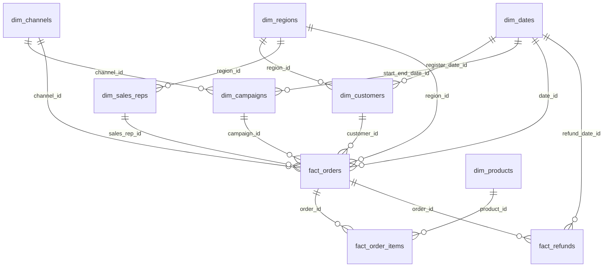

# AskData 数据字典（D1）

> 版本：v0.1
> 日期：2026-11-05
> 对应文件：`data/schema.sql`、`data/seed.sql`
> 生成脚本：`scripts/generate_seed.py`
> 校验脚本：`scripts/validate_seed.py`
> 数据性质：**确定性合成的演示数据，不是真实客户数据**

---

## 0. 总览

| 表 | 粒度 | 行数 | 主键 | 说明 |
|---|---|---:|---|---|
| `dim_dates` | 一天一行 | 730 | `date_id` | 2025-01-01 至 2026-12-31 |
| `dim_regions` | 一个区域一行 | 12 | `region_id` | 7 个大区，含区域别名 |
| `dim_channels` | 一个渠道一行 | 5 | `channel_id` | App/官网/小程序/线下/电商平台 |
| `dim_products` | 一个商品一行 | 20 | `product_id` | 7 个品类、6 个品牌 |
| `dim_customers` | 一个客户一行 | 60 | `customer_id` | 名称/手机号已脱敏 |
| `dim_campaigns` | 一个活动一行 | 6 | `campaign_id` | 618/双 11/818/年货节 |
| `dim_sales_reps` | 一个销售一行 | 14 | `rep_id` | 华东 8 人，便于 top 5 销售题 |
| `fact_orders` | 一个订单一行 | 438 | `order_id` | 事实数据截至 2026-11-05 |
| `fact_order_items` | 一个订单商品一行 | 1,014 | `item_id` | 订单明细 |
| `fact_refunds` | 一次退款一行 | 58 | `refund_id` | 含部分退款/全额退款 |

**时间边界**

- 日期维：`2025-01-01` 至 `2026-12-31`（含未来日期，供活动结束日/筛选使用）。
- 事实数据：`2025-01-01` 至 `2026-11-05`。
- 时区：`Asia/Shanghai`；`date_id` 格式 `YYYYMMDD`。

**分布**

- 订单状态：`delivered` 229、`shipped` 87、`paid` 78、`refunded` 32、`cancelled` 12。
- 客户分层：`active` 37、`vip` 10、`churn` 10、`new` 3。
- 退款原因：`NULL` 13、质量问题 9、其他 9、不喜欢 9、尺码不合适 7、发错货 6、物流太慢 5。
- 渠道订单：App 180、官网 91、小程序 70、电商平台 42、线下门店 38、`NULL` 17。

---

## 1. 关键约定

### 1.1 日期

- `date_id = YYYYMMDD`，例如 `20261001`。
- `week_num` 用 ISO 周；`day_of_week` 用 1=周一、7=周日。
- `is_holiday` 为演示用近似节假日标记，不是权威日历。
- 事实表统一用 `date_id` 关联；退款用 `refund_date_id`。

### 1.2 区域

- `region_group` 是 7 个大区：华东、华北、华南、华中、西南、西北、东北。
- `aliases` 是逗号分隔的别名，例如 `华东,华东区,江浙沪,上海`。
- “华东”默认映射 `region_group = '华东'`；如果需要按省份集合，另走 `province IN (...)`。
- 华东包含 6 个城市：上海、南京、杭州、合肥、苏州、宁波。

### 1.3 状态

- 订单：`paid` / `shipped` / `delivered` / `cancelled` / `refunded`。
- 退款：`requested` / `approved` / `rejected` / `completed`。
- 客户分层：`new` / `active` / `vip` / `churn`。

### 1.4 指标口径

- `GMV` 排除 `cancelled` 订单；按 `fact_orders.date_id` 统计。
- `净收入 = GMV - 退款金额`；退款按订单归集，避免按下单时间/退款时间漂移。
- `退款率 = 退款金额 / GMV`。
- `退货率 = 发生退款的订单数 / 已支付订单数`（demo 用退款订单近似退货订单）。
- `复购率 = 订单数 ≥2 的客户数 / 支付客户数`。
- `毛利率 = (净收入 - 商品成本) / 净收入`。
- 详细公式见 `data/metrics.yml`。

### 1.5 NULL 语义

- `fact_orders.channel_id` 可为 NULL：渠道未知。
- `fact_orders.campaign_id` 可为 NULL：非活动订单。
- `fact_orders.sales_rep_id` 可为 NULL：未分配销售。
- `fact_refunds.reason` 可为 NULL：未填写原因。
- NULL 不等于 0；聚合时应使用 `COALESCE` 或明确过滤。

---

## 2. 表结构

### 2.1 `dim_dates`

| 列 | 类型 | 约束 | 说明 |
|---|---|---|---|
| `date_id` | INTEGER | PK | `YYYYMMDD` |
| `date_value` | DATE | NOT NULL | ISO 日期 |
| `year_num` | INTEGER | NOT NULL | 年 |
| `quarter_num` | INTEGER | NOT NULL | 季度 1–4 |
| `month_num` | INTEGER | NOT NULL | 月 1–12 |
| `week_num` | INTEGER | NOT NULL | ISO 周 |
| `day_of_week` | INTEGER | NOT NULL | 1=周一…7=周日 |
| `is_holiday` | INTEGER | CHECK 0/1 | 演示节假日标记 |

### 2.2 `dim_regions`

| 列 | 类型 | 约束 | 说明 |
|---|---|---|---|
| `region_id` | INTEGER | PK | 区域 ID |
| `province` | TEXT | NOT NULL | 省 |
| `city` | TEXT |  | 城市 |
| `region_group` | TEXT | CHECK 7 大区 | 大区 |
| `aliases` | TEXT |  | 逗号分隔别名 |

### 2.3 `dim_channels`

| 列 | 类型 | 约束 | 说明 |
|---|---|---|---|
| `channel_id` | INTEGER | PK | 渠道 ID |
| `channel_name` | TEXT | NOT NULL | 渠道名 |
| `channel_type` | TEXT | CHECK | `app/web/mini_program/offline/marketplace` |

### 2.4 `dim_products`

| 列 | 类型 | 约束 | 说明 |
|---|---|---|---|
| `product_id` | TEXT | PK | 商品 ID |
| `name` | TEXT | NOT NULL | 商品名 |
| `category` | TEXT | NOT NULL | 品类 |
| `brand` | TEXT |  | 品牌 |
| `cost` | NUMERIC(12,2) | NOT NULL | 成本 |
| `list_price` | NUMERIC(12,2) | NOT NULL | 标价 |

### 2.5 `dim_customers`

| 列 | 类型 | 约束 | 说明 |
|---|---|---|---|
| `customer_id` | TEXT | PK | 客户 ID |
| `name_masked` | TEXT | NOT NULL | 脱敏姓名 |
| `region_id` | INTEGER | FK → `dim_regions` | 所属区域 |
| `segment` | TEXT | CHECK | `new/active/vip/churn` |
| `register_date_id` | INTEGER | FK → `dim_dates` | 注册日期 |
| `phone_masked` | TEXT |  | 脱敏手机号 |

说明：

- `C051`–`C053` 的注册日期是 `2026-11-04`，用于“昨天新增客户数”题。
- `segment` 由订单历史派生：top 10 → `vip`；120 天无订单 → `churn`；≥2 单 → `active`；否则 `new`。

### 2.6 `dim_campaigns`

| 列 | 类型 | 约束 | 说明 |
|---|---|---|---|
| `campaign_id` | INTEGER | PK | 活动 ID |
| `name` | TEXT | NOT NULL | 活动名 |
| `start_date_id` | INTEGER | FK → `dim_dates` | 开始日 |
| `end_date_id` | INTEGER | FK → `dim_dates` | 结束日 |
| `channel_id` | INTEGER | FK → `dim_channels` | 主要渠道 |
| `budget` | NUMERIC(12,2) |  | 预算 |

说明：`双 11 2026` 结束于 `2026-11-11`，因此日期维延伸到 `2026-12-31`。

### 2.7 `dim_sales_reps`

| 列 | 类型 | 约束 | 说明 |
|---|---|---|---|
| `rep_id` | INTEGER | PK | 销售 ID |
| `name` | TEXT | NOT NULL | 脱敏姓名 |
| `region_id` | INTEGER | FK → `dim_regions` | 所属区域 |
| `manager_id` | INTEGER |  | 上级 ID（自引用，未建 FK） |

说明：华东有 8 名销售，支持“华东区 top 5 销售”题。

### 2.8 `fact_orders`

| 列 | 类型 | 约束 | 说明 |
|---|---|---|---|
| `order_id` | TEXT | PK | 订单 ID，`ORD+日期+序号` |
| `customer_id` | TEXT | FK → `dim_customers` | 客户 |
| `region_id` | INTEGER | FK → `dim_regions` | 下单区域 |
| `channel_id` | INTEGER | FK → `dim_channels`，可 NULL | 渠道 |
| `campaign_id` | INTEGER | FK → `dim_campaigns`，可 NULL | 活动 |
| `sales_rep_id` | INTEGER | FK → `dim_sales_reps`，可 NULL | 销售 |
| `date_id` | INTEGER | FK → `dim_dates` | 下单日期 |
| `gross_amount` | NUMERIC(12,2) | NOT NULL | 商品原金额 |
| `discount` | NUMERIC(12,2) | NOT NULL | 订单折扣 |
| `net_amount` | NUMERIC(12,2) | NOT NULL | 折后金额 |
| `status` | TEXT | CHECK | 订单状态 |
| `created_at` | TIMESTAMP | NOT NULL | 创建时间 |

口径：`net_amount = gross_amount - discount`；`GMV` 排除 `cancelled`。

### 2.9 `fact_order_items`

| 列 | 类型 | 约束 | 说明 |
|---|---|---|---|
| `item_id` | INTEGER | PK | 明细 ID |
| `order_id` | TEXT | FK → `fact_orders` | 订单 |
| `product_id` | TEXT | FK → `dim_products` | 商品 |
| `quantity` | INTEGER | CHECK >0 | 数量 |
| `unit_price` | NUMERIC(12,2) | NOT NULL | 成交单价 |
| `discount` | NUMERIC(12,2) | NOT NULL | 行折扣 |
| `amount` | NUMERIC(12,2) | NOT NULL | 行金额 |

说明：一行一个商品；成本分析需 JOIN `dim_products.cost`。

### 2.10 `fact_refunds`

| 列 | 类型 | 约束 | 说明 |
|---|---|---|---|
| `refund_id` | TEXT | PK | 退款 ID |
| `order_id` | TEXT | FK → `fact_orders` | 订单 |
| `refund_amount` | NUMERIC(12,2) | CHECK ≥0 | 退款金额 |
| `reason` | TEXT | 可 NULL | 退款原因 |
| `status` | TEXT | CHECK | 退款状态 |
| `refund_date_id` | INTEGER | FK → `dim_dates` | 退款日期 |
| `created_at` | TIMESTAMP | NOT NULL | 创建时间 |

说明：一个订单可以有多条退款；当前 demo 主要是一对一，部分退款/全额退款混合。

---

## 3. 关系图



---

## 4. 脏数据与边界

| 类型 | 现状 | 目的 |
|---|---|---|
| 渠道缺失 | 17 个订单 `channel_id = NULL` | 测试 `COALESCE` / 未知渠道 |
| 退款原因缺失 | 13 条退款 `reason = NULL` | 测试 NULL 分组 |
| 活动缺失 | 多数订单 `campaign_id = NULL` | 测试非活动订单 |
| 销售缺失 | 约 10% 订单 `sales_rep_id = NULL` | 测试未分配销售 |
| 区域别名 | 华东/华东区/江浙沪/上海等 | 测试 schema linking / 语义层 |
| 日期边界 | 月末、节假日、双 11 | 测试时间窗口 |
| 部分退款 | 退款金额 30%–100% 订单金额 | 测试退款率/净收入 |
| 重复购买 | 部分客户 10+ 单，部分 1 单 | 测试复购率 |
| 空值 vs 0 | `NULL` 不等于 0 | 防聚合错误 |

---

## 5. D1 校验结果

在 SQLite 内存库执行 `schema.sql` + `seed.sql`，并开启 `PRAGMA foreign_keys = ON`：

- 外键检查：`PRAGMA foreign_key_check` 返回空。
- 行数：10 张表全部非空；订单 438、明细 1,014、退款 58。
- Q001 上月 GMV：`61,609.57`
- Q002 上月净收入：`58,208.56`
- Q005 上月退款金额：`2,542.27`
- Q006 上月退款率：`4.13%`
- Q009 昨天新增客户：`3`
- Q013 华东 Q3 top 10 商品：非空，第一名为 `视界 27 寸显示器`（17,643.95）
- Q017 上月复购率：`0.56`
- Q019 华东上月 top 5 销售：5 行
- Q020 上月退款原因：7 条（含 2 条 NULL）
- Q026 华东城市订单 top 5：合肥、杭州、南京、上海、宁波
- Q031 2025-11 vs 2026-11 GMV：`38,711.85` vs `24,989.88`
- Q029 连续 3 月 GMV 增长品类：网络、配件
- Q036 连续 3 月毛利率下降品类：存储、智能穿戴

> Q030 全时段复购率会出现 100% 的区域，Q033 top 10 客户复购 GMV 占比为 100%：这是合成数据的“复购偏置”，用于测试嵌套 SQL，不代表真实业务分布。需要更真实的分布时，可在生成脚本里加入一次性客户/长尾客户。

---

## 6. 已知限制

- 合成数据，不代表真实电商分布；不要用它的绝对值对外承诺。
- `dim_dates.is_holiday` 为演示近似，不是权威节假日。
- 无流量/曝光表，无法计算转化率；如需转化率，D2 加 `fact_traffic`。
- `return_rate` 用退款订单近似退货订单；真实退货需 `fact_returns`。
- `manager_id` 自引用但未建 FK，避免 seed 顺序复杂。
- SQLite 为演示库；Postgres 迁移时需补 identity/date/fk 约束核对。
- gold SQL 与预期结果在 D7 补；当前问题集只冻结“问什么/涉及什么/期望路由”。

---

## 7. 加载方式

SQLite：

```bash
sqlite3 data/askdata.db < data/schema.sql
sqlite3 data/askdata.db < data/seed.sql
```

或 Python：

```python
import sqlite3
conn = sqlite3.connect("data/askdata.db")
conn.execute("PRAGMA foreign_keys = ON")
conn.executescript(open("data/schema.sql", encoding="utf-8").read())
conn.executescript(open("data/seed.sql", encoding="utf-8").read())
conn.commit()
```

重新生成：

```bash
python scripts/generate_seed.py
python scripts/validate_seed.py
```

---

## 8. 与 D0 问题集/指标的映射

- 8 个核心指标：GMV、净收入、订单数、客单价、退款率、退货率、复购率、毛利率。
- 3 个辅助度量：退款金额、新增客户数、支付客户数。
- 10 张表全部被 `docs/questions.md` 的 40 条问题覆盖。
- 典型问题到表/指标的映射见 `docs/questions.md` 的“覆盖检查”。
